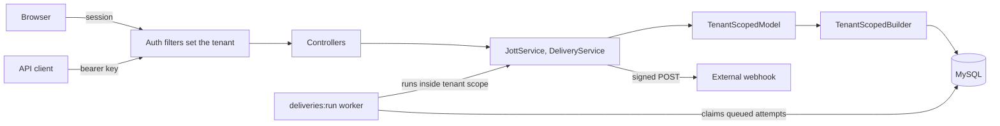

# Jottin

Multi-tenant note capture for people who automate. Write a short note (a "jott"), and hashtags file it into collections. Other tools can push jotts in through an API, and each collection can send its jotts out to a webhook.

**Live at https://jottin.app.** Built with PHP 8.3, CodeIgniter 4.7 and MySQL 8, running on AWS Lightsail with Docker Compose and Caddy.

## Run it locally

Requires Docker with Compose. PHP and Composer run inside the container.

```bash
cp .env.example .env          # then set real values, as the file describes
docker compose up -d --build
docker compose exec -u www-data app composer install
docker compose exec -u www-data app php spark migrate --all
```

Open http://localhost:8080 and create a workspace. `GET /health` reports app and database status.

To run lint, static analysis and tests:

```bash
docker compose exec -u www-data app composer check
```

## Demo in five minutes

This uses the local stack, which includes a controllable test receiver (see [`docs/WEBHOOKS.md`](docs/WEBHOOKS.md)). The live site has no test receiver, and it refuses private addresses, so a demo there needs a public webhook URL.

1. **Capture:** create a workspace and save `Prepare examples for #Interview and #SaaS`. Both collections appear on their own.
2. **Isolation:** create a second workspace in a private window, then paste the first workspace's jott URL. It returns 404.
3. **Manual collection:** open the jott and add it to a new collection. The editor separates "From hashtags" from "Added manually".
4. **Inbound API:** create a key under **API keys** and POST a jott (see [`docs/API.md`](docs/API.md)).
5. **Manual delivery:** in **Settings & history** on `#interview`, set the URL to `http://receiver/ok` and the mode to Manual. Select a jott, send it, and confirm.
6. **Honest failure:** change the URL to `http://receiver/fail`, re-arm the jott and send again. The history shows HTTP 500.
7. **Automatic delivery:** set the URL back to `/ok` and the mode to Automatic, then POST a tagged jott. The worker delivers it.
8. **Audit:** open **Audit log** to see who did what, with no note text in it.

## Architecture



| Layer | Responsibility |
|---|---|
| **Filters** | Authenticate the request and set the tenant, from the session or API key only |
| **Controllers** | Translate HTTP to service calls |
| **Services** | Hold the business rules, shared by the web UI, API and worker |
| **Scoped models and builder** | Make every query tenant-bound |
| **MySQL** | Second line of defense: composite foreign keys, unique keys, and audit triggers |

## Tenancy

One shared database, with `tenant_id` on every tenant-owned row, enforced when SQL is compiled so a feature can't forget it. CI fails on an unscoped model, direct database access, a table without `tenant_id`, or a foreign key between tenant tables that omits it.

[`docs/TENANCY.md`](docs/TENANCY.md) covers the design, its limits, and shared schema vs schema per tenant vs database per tenant.

Three deliberate unscoped reads exist, each allowlisted in a test with its reason: sign-in lookup, API key lookup, and the worker's queue claim. In each, the tenant isn't known until that row is read.

## Security

| Area | Approach |
|---|---|
| **Passwords** | `password_hash`, minimum 12 characters, rehashed at sign-in if the algorithm changes |
| **Sessions** | Stored in MySQL, `HttpOnly`, `SameSite=Lax`, `Secure` in production, with the ID rotated at sign-in |
| **CSRF** | Session-based token on all browser POSTs; the cookie-less API is exempt |
| **Output** | `esc()` in views, backed by a content security policy with no inline scripts |
| **Sign-in** | Rate limited, with the same response and timing for unknown emails |
| **API keys** | Shown once and stored as SHA-256 hashes, rate limited, revocable |
| **Webhooks** | SSRF checks at save and send time, pinned connections, no redirects, HMAC signatures, URLs and secrets encrypted at rest |
| **Audit log** | Append-only through database triggers, holding identifiers and never note text |
| **Secrets** | From the environment, with `.env` gitignored and CI scanning full history with gitleaks |

**This isn't a compliance claim.** It applies practices relevant to sensitive data, but it hasn't had a security review, and HIPAA also involves things outside the code, such as agreements, access policies, backups and monitoring.

## What's built, and what's deferred

The spec's acceptance tests are covered by automated tests, except that the 320px check was measured in a browser rather than automated, and real sign-out was checked over HTTP because the framework disables session destruction in its test environment.

**Deferred, because it didn't fit one day or needs a product decision:**

| Area | Deferred |
|---|---|
| **Accounts** | Password reset and email verification (both need email sending), email invites, social or magic-link sign-in, signing out other sessions on password change, forced change of generated passwords, auditing sign-ins |
| **Delivery** | Retries, per-tenant delivery limits, test deliveries, rotating signing secrets and the encryption key |
| **API** | Rotating keys (revoke and create instead), key scopes and expiry |
| **Collections** | Deleting collections, live tag preview while typing |
| **Feed** | Pagination (the newest 100 are shown) |
| **Operations** | Monitoring and alerts, automated deploys, a managed database. See [`docs/DEPLOY-AWS.md`](docs/DEPLOY-AWS.md) for the current setup and its limits |

**Decided against for now:** per-tenant subdomains (see [`docs/TENANCY.md`](docs/TENANCY.md)).

**Out of scope in the spec:** billing, export, search, attachments, and public read APIs.

The spec excludes multi-user accounts, but this build adds owner and member roles deliberately, because roles and auditability were goals of the exercise.

## Documentation

| File | Contents |
|---|---|
| [`NOTES-interview.md`](NOTES-interview.md) | Talking points on the engineering decisions |
| [`docs/TENANCY.md`](docs/TENANCY.md) | Isolation design and tradeoffs |
| [`docs/API.md`](docs/API.md) | The inbound API, including Webhooker setup |
| [`docs/WEBHOOKS.md`](docs/WEBHOOKS.md) | Outbound delivery, signatures and SSRF protection |
| [`docs/CI3-TO-CI4.md`](docs/CI3-TO-CI4.md) | CodeIgniter 3 vs 4, and migrating incrementally |
| [`docs/DEPLOY-AWS.md`](docs/DEPLOY-AWS.md) | How the live site is deployed, what it costs, and its limits |
| [`docs/DEPLOY-GCP.md`](docs/DEPLOY-GCP.md) | How this would map to Cloud Run and Cloud SQL (not deployed) |
| [`docs/AI-ASSIST-NOTES.md`](docs/AI-ASSIST-NOTES.md) | How AI was used, what it got wrong, and governance |
