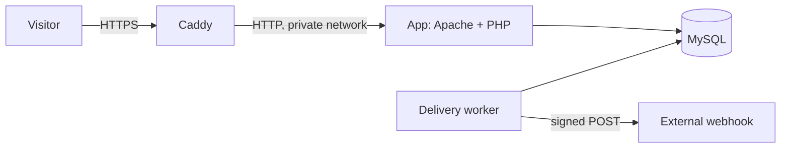

# Deployment

Jottin runs at **https://jottin.app** on one AWS Lightsail server.



## What runs where

| Piece | Where |
|---|---|
| **Server** | Lightsail `small_3_0` in `us-east-1`: 2 GB RAM, 2 vCPUs, 60 GB disk, Ubuntu 24.04, plus 1 GB of swap |
| **Containers** | Caddy, app, worker and MySQL, defined in `docker-compose.prod.yml` |
| **HTTPS** | Caddy gets and renews Let's Encrypt certificates on its own |
| **DNS** | Vercel DNS: `A` records for `jottin.app` and `www` point at the server's static IP |
| **Backups** | Lightsail automatic daily snapshots |
| **OS patches** | Ubuntu's unattended security upgrades |

**Network:** the firewall allows 80 and 443 from anywhere, and SSH from one IP address plus Lightsail's browser console. MySQL and the app aren't reachable from outside.

**Secrets:** a `.env` file on the server, readable only by its owner, and never in Git. It's created once with:

```bash
umask 077
printf 'DB_PASSWORD=%s\nDB_ROOT_PASSWORD=%s\nENCRYPTION_KEY=hex2bin:%s\n' \
  "$(openssl rand -hex 24)" "$(openssl rand -hex 24)" "$(openssl rand -hex 32)" > .env
```

Losing `ENCRYPTION_KEY` makes stored webhook URLs and signing secrets unreadable. Snapshots include it, but a copy belongs in a password manager.

## Deploying a change

After merging to `main`, on the server:

```bash
cd ~/jottin && ./scripts/deploy.sh
```

It pulls, rebuilds, restarts, migrates, and reports success only after a real health response. There's a brief interruption during the restart, and no automatic rollback: to go back, run `./scripts/deploy.sh` for an earlier state or restore a snapshot.

## Cost

| Item | Monthly |
|---|---|
| Lightsail `small_3_0`, including the static IP and 3 TB of transfer | $12.00 |
| Snapshots at $0.05 per GB-month | About $0.50 for 10 GB of data |

## Limits of this setup

This suits a demo or an early product. For real customers, these would need work:

- **One server:** if it goes down, so does the app, and a restore means rebuilding from a snapshot.
- **MySQL on the same box:** a managed database would improve backups and failover, at a higher cost.
- **No monitoring or alerts:** nothing tells anyone if the site goes down.
- **Short logs:** container logs and `writable/logs` are limited, and don't survive the container being recreated.
- **Manual deploys:** CI checks the code, but a person runs the deploy.
- **Open sign-up:** there's no email verification, and sign-ups are only rate limited per IP.
- **Single-server rate limits:** fine on one server, but they'd need a shared cache on several.

`docs/DEPLOY-GCP.md` describes how this would map to Google Cloud.
